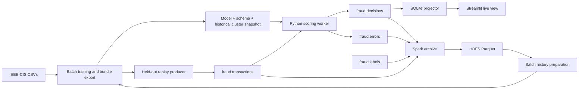

# Kafka and Hadoop integration

The research pipeline now has a serving path: real held-out transactions enter
Kafka, a Python worker scores them using an exported LightGBM model and historical
cluster features, and `policy.py` determines the action. A separate consumer
projects decisions into SQLite for the Streamlit console. Spark archives all four
topics into Parquet on Hadoop HDFS.



## Run on Windows with Docker Desktop

Use Docker Desktop with Linux containers/WSL2. Run these commands from the
repository root in PowerShell. Allow enough Docker memory for the original
in-memory training pipeline plus Java services; 12 GB is a reasonable starting
allocation, and training can be run before the Java services to reduce peak use.
The first build downloads Hadoop, Spark, and Python dependencies.

1. Place the actual `train_transaction.csv` and `train_identity.csv` in `data/`
   using the existing Kaggle setup. Data and generated artifacts remain ignored
   by Git. There is no generated-data fallback.

2. Build and export a bundle. This trains the existing baseline and cluster
   models once; it makes no LLM calls and does not regenerate research reports.

   ```powershell
   docker compose build tools
   docker compose run --rm tools -m src.streaming.export --output artifacts/demo
   ```

   The output directory must be new. A completed export contains `model.txt`,
   `manifest.json`, `cluster_features.parquet`, `membership.parquet`, and
   `replay.parquet`. The replay file contains only the temporal holdout and
   excludes `isFraud`. A manifest is written last; interrupted exports are not
   loadable. Use a new output name when rebuilding.

3. Start Kafka, HDFS, scoring, archival, and the dashboard:

   ```powershell
   docker compose --profile streaming up -d --build
   docker compose ps -a
   docker compose logs --tail 50 scorer archive
   ```

   `topic-init` should exit successfully. The scorer and projector wait for it;
   Spark additionally waits for a live HDFS DataNode. Spark may need extra time
   on its first start to download the Kafka connector from Maven.

4. Replay real observations:

   ```powershell
   docker compose run --rm tools -m src.streaming.producer --bundle artifacts/demo --limit 200 --rate 10
   ```

   Open **http://localhost:8501** for the live console and
   **http://localhost:9870** for the HDFS NameNode UI. The container console
   defaults to Live Kafka decisions. Local `streamlit run app.py` retains the
   Research console default; choose the live mode with the Data source selector.
   The live view refreshes every two seconds and does not load or train models.

5. Verify the real Kafka round trip and archive:

   ```powershell
   docker compose run --rm tools -m src.streaming.smoke --bundle artifacts/demo
   docker compose exec namenode hdfs dfs -ls -R /fraud/events
   docker compose logs --tail 30 archive
   ```

   Spark writes approximately every 30 seconds when records are available.
   Expect topic/event-day directories containing Parquet plus `_spark_metadata`.
   The smoke check publishes one actual held-out observation, waits for its
   decision using Kafka source coordinates, and compares it to local scoring.

Stop services with `docker compose --profile streaming down`. Named Kafka/HDFS
volumes and the host `runtime/decisions.sqlite` persist. Use `up` again to resume;
the workers continue from their committed offsets and Spark's checkpoint.

## Python commands without application containers

Use Python 3.13 for the repository's pinned research requirements:

```powershell
python -m pip install -r requirements-streaming.txt
python -m src.streaming.export --output artifacts/demo
python -m src.streaming.topics
python -m src.streaming.scorer --bundle artifacts/demo
```

Run these in separate terminals while Kafka is running:

```powershell
python -m src.streaming.store
python -m src.streaming.producer --bundle artifacts/demo --limit 200 --rate 10
streamlit run app.py
```

The default Kafka address is `localhost:9092`; inside Compose it is
`kafka:19092`. Override with `KAFKA_BOOTSTRAP_SERVERS`. `FRAUD_DECISION_DB`
selects the SQLite path. For an external authenticated broker,
`KAFKA_CONFIG_FILE` can point at an untracked JSON file containing shared
Confluent client security settings. The bundled Spark demo uses the local
plaintext broker; external Spark authentication must be configured separately.

## Topics, schemas, and delivery

| Topic | Key | Payload |
|---|---|---|
| `fraud.transactions` | UID, or TransactionID when UID is absent | `schema_version`, stable `event_id`, `transaction` object |
| `fraud.decisions` | Deterministic `decision_id` | Model score, action, threshold, UID/cluster, feature values, versions, input Kafka coordinates |
| `fraud.labels` | TransactionID | Explicit `isFraud`, `transaction_id`, timezone-aware `label_observed_at` |
| `fraud.errors` | Input topic/partition/offset | Validation error, original bytes as base64, source coordinates |

An observation must provide every input field listed in the bundle manifest;
unavailable fields must be explicit JSON nulls. Label and cluster-feature
injection are rejected. Categories and numeric precision are reconstructed from
the training schema; unseen categories become missing, matching LightGBM's
categorical behavior. Unknown/missing UIDs retain the transaction with null
cluster features. Every event must be at or after the snapshot boundary.

The local topics have one partition, preserving producer order for the demo.
For more parallelism, create topics with `topics --partitions N` before first
use, and run scorer workers with distinct, stable `--worker-id` values. Kafka
ordering is per partition. This implementation uses a fixed historical graph;
it does not merge graph state across streaming workers.

The scorer uses Kafka transactions to atomically commit its output and consumed
offset. Readers use `read_committed`. Invalid events go to `fraud.errors` in the
same transaction; model/infrastructure failures abort and stop the worker, so a
restart can retry. Each worker ID must have only one active process.

Producer restarts/replays can still publish the same business event more than
once. Decision IDs include the event ID, model hash, feature snapshot hash, and
thresholds. SQLite inserts by this primary key, commits, and then acknowledges
Kafka. A projector crash cannot silently lose an acknowledged decision. If the
SQLite file is deliberately replaced, use a new projector `--group` to rebuild
from retained Kafka history. Keep event IDs stable and unique per observation;
changing an observation requires a new event ID.

Spark retains raw payloads, Kafka timestamps, topic/partition/offset, extracted
IDs, and an `envelope_valid` flag. Invalid envelopes remain inspectable in the
archive. Partitioning uses `event_day = floor(TransactionDT / 86400)` because
IEEE-CIS timestamps are relative seconds, not calendar dates. Events without
that timestamp use day -1. Keep the output and checkpoint together; starting a
fresh checkpoint against existing output is not a supported recovery procedure.
Kafka retention must exceed archive outages (`failOnDataLoss=true` detects gaps).
Application duplicates remain in raw history; batch preparation deduplicates by
transaction ID. Schedule file compaction if small streaming Parquet files grow
numerous.

## Historical data and retraining

Real label events can be published from JSONL using:

```powershell
docker compose run --rm tools -m src.streaming.labels --input data/observed_labels.jsonl
```

Each line must contain `transaction_id`, integer `isFraud` (0 or 1), and
`label_observed_at` with a timezone. The IEEE-CIS CSV does not provide label
arrival times, so this project does not invent them or auto-publish its labels
as if they were live outcomes. Unlabeled observations are never assumed clean.

Once observed labels have been archived, prepare a new historical dataset.
Choose the real label-availability cutoff for your run:

```powershell
docker compose run --rm archive /app/jobs/prepare_history.py --manifest /app/artifacts/demo/manifest.json --labels-as-of 2026-10-19T00:00:00Z --output file:///app/artifacts/history-20261019
docker compose run --rm tools -m src.streaming.export --history-parquet artifacts/history-20261019 --output artifacts/next
```

The batch job reads HDFS, keeps the latest label observed strictly before the
cutoff, and joins it to deduplicated observations. Its new local Parquet output
is mounted into the exporter. It can instead write an `hdfs://` output. Direct
Python HDFS reads also work through `load_history_parquet`, but require Hadoop's
`libhdfs`, Java, and Hadoop client configuration; the application image does not
include those. The Spark-to-mounted-Parquet route avoids that requirement.

To retain a completed serving bundle in HDFS:

```powershell
docker compose exec namenode hdfs dfs -mkdir -p /fraud/bundles
docker compose exec namenode hdfs dfs -put /artifacts/demo /fraud/bundles/demo
```

Deploy a new snapshot by changing the scorer's `--bundle` path and restarting
it at a controlled event-time boundary. Older outstanding transactions will be
dead-lettered by a newer snapshot; drain them with the previous bundle first.
Serving does not refresh features or switch models implicitly.

## Scope and model limitations

This adds a working transport/serving/storage architecture around the existing
research model. pandas, NetworkX, and model training remain single-machine;
HDFS storage does not make them distributed. Spark runs `local[2]` in the demo;
YARN and distributed graph construction are future deployment work.

The original training method broadcasts one full train-window snapshot onto
training rows, including their own fraud-label history. Its fixed policy
thresholds were selected using research test scores. These limitations are
recorded in every exported manifest and are not corrected by Kafka/Hadoop.
Point-in-time training features, label-latency experiments, validation-only
threshold selection, and new model-quality claims require a separate measured
training change. The serving snapshot itself excludes the test period, and
incoming label events never mutate it.

The live view displays recorded decisions and audit details. Graph exploration,
SHAP, and optional LLM narratives remain available in the Research console;
there are no automatic LLM calls in the new streaming services.

Compose is a local development setup: one Kafka broker, one DataNode, replication
factor 1, HDFS permissions disabled, and host ports bound to loopback. It does
not provide production authentication, replication, or high availability.

## Validation

```powershell
python -m pytest tests/ -q
python -m compileall -q src jobs dashboard_live.py
docker compose config --quiet
```

`tests/test_streaming.py` checks saved-model parity (including categorical order,
unseen values, and null UIDs), event-time rejection, label/feature injection,
bundle integrity, atomic Kafka API call sequencing/abort behavior, and projector
deduplication. Broker guarantees require the real round-trip smoke check above.
Spark transformations have optional tests in `tests/test_streaming_spark.py`,
enabled with `RUN_SPARK_TESTS=1` in an environment with PySpark 3.5.8 and Java.

Official references: [Kafka Docker image](https://kafka.apache.org/41/getting-started/docker/),
[Confluent Python transaction API](https://docs.confluent.io/platform/current/clients/confluent-kafka-python/html/index.html),
[Spark Kafka integration](https://spark.apache.org/docs/3.5.8/structured-streaming-kafka-integration.html),
[Hadoop single-node setup](https://hadoop.apache.org/docs/r3.4.2/hadoop-project-dist/hadoop-common/SingleCluster.html).
